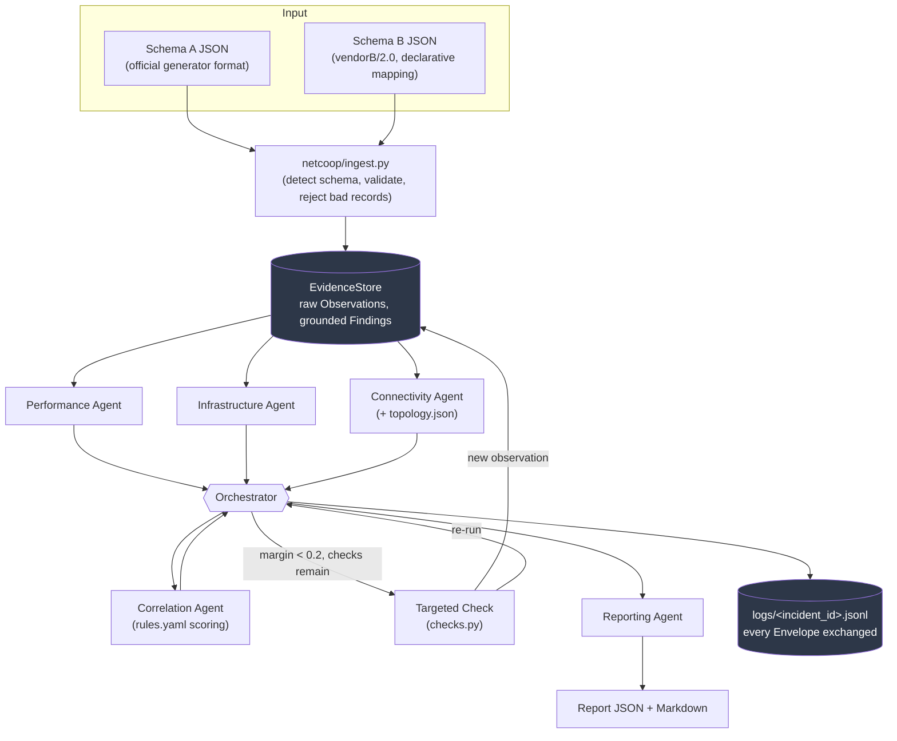

# NetCoop AI

Multi-agent network fault diagnosis for the Agentic AI Grand Finale (Tech
Zephyr 4.0, IIT Bhubaneswar). Five specialized agents exchange structured,
self-grounding evidence over a shared protocol, correlate it into ranked
hypotheses, and produce a single evidence-backed diagnostic report — JSON and
Markdown — with confidence, alternatives, and recommended actions.

All code lives under **[netcoop-ai/](netcoop-ai/)** — every command below is
run from inside that directory. For the generated field reference, the full
error-code catalog, and the complete correlation/checks design, see
**[netcoop-ai/docs/PROTOCOL.md](netcoop-ai/docs/PROTOCOL.md)**; this README
is the project overview.

## Problem

IIT Bhubaneswar's campus network — hostel Wi-Fi, department Ethernet,
routers, switches, lecture halls — sees intermittent faults whose cause
(congestion, a bad interface, weak Wi-Fi, a DNS/DHCP outage, CPU overload, or
genuine hardware failure) isn't obvious from any single metric, and whose
telemetry is incomplete, stale, inconsistent, or arrives in incompatible
vendor formats. The challenge is to diagnose the probable root cause from
distributed, imperfect evidence — and, just as importantly, to say
*"insufficient evidence"* rather than confidently guess wrong when the data
doesn't actually support a conclusion.

NetCoop AI's answer is **evidence-first cooperative diagnosis**: every claim
an agent makes is graded by a shared `EvidenceStore` from what it actually
cites, never taken on the agent's word; root cause is decided by
deterministic rules and scoring, never an LLM; and the system abstains when
the evidence genuinely doesn't support a specific cause (verified
numerically in [Evaluation results](#evaluation-results) below: 0 false
confident diagnoses on the bundled ambiguous scenarios, vs. 4/4 for a naive
baseline that can't abstain).

## Architecture



Every arrow between agents and the orchestrator is a single message shape,
`Envelope` (`netcoop/protocol.py`) — see PROTOCOL.md for the full generated
field reference, message types, and versioning policy.

## Agent responsibilities

| Agent | Module | Scope |
|---|---|---|
| **Performance** | `agents/performance.py` | latency, jitter, packet loss, throughput, bandwidth, link utilization |
| **Infrastructure** | `agents/infrastructure.py` | device status, CPU, memory, interface errors, queue drops |
| **Connectivity** | `agents/connectivity.py` | shared-upstream scope of the affected devices (via topology), wired vs. wireless segment mix, DNS/DHCP failures. No topology → explicitly flags `"scope limited to reporting device"` rather than guessing |
| **Correlation** | `agents/correlation.py` | builds one scored `Hypothesis` per rule in `rules.yaml` from the raw evidence, ranks them, resolves the hardware-failure co-occurrence case, decides when a targeted check is warranted |
| **Reporting** | `agents/reporting.py` | turns the ranking into the final `Report`, tracing every piece of supporting evidence back to a raw record, and splits out a second diagnosis when devices fall in non-overlapping topology scopes |

Performance, Infrastructure, and Connectivity's per-metric logic is entirely
data-driven from `rules.yaml`'s `signals` list (metric, comparison,
threshold, owning agent, which hypotheses it supports/contradicts and by how
much) — none of them contain hand-written per-hypothesis `if` logic.

## Orchestration flow

```
ingest(file) -> EvidenceStore
  -> dispatch TASK to Performance, Infrastructure, Connectivity
       -> each reply validated (well-formed Envelope, no reused msg_id,
          within its time limit); a failure is caught, logged as an ERROR
          Envelope, and the run continues with whatever succeeded
  -> dispatch TASK to Correlation -> ranked Hypotheses per device
  -> while margin < 0.2 and checks remain (max 2):
       look up the named check that discriminates the top two hypotheses
       -> request it -> if applied, re-dispatch everything above
  -> ReportingAgent builds the final Report
```

Every `Envelope` exchanged — including `check_request`/`check_result` pairs
and the terminal `report` — is appended to `logs/<incident_id>.jsonl`, one
JSON object per line: a complete, replayable audit trail. `python -m netcoop
run` renders this live as a colored timeline (via
[rich](https://github.com/Textualize/rich)).

## Evidence correlation and confidence

For each hypothesis, every `rules.yaml` signal is re-evaluated **directly
against the raw EvidenceStore** — never against what an agent merely claims
fired, so a fabricated "rumor" Finding cannot move a score:

```
score = clamp((support_weight - contradiction_weight) / possible_support_weight, 0, 1) * coverage
margin = top score - second-best score
```

`coverage` is the fraction of a hypothesis's required metrics that are
present *and fresh* (stale readings are excluded and listed in
`limitations`, not silently trusted). Confidence category: **High** if
score ≥ 0.75 and margin ≥ 0.2; **Medium** if score ≥ 0.5 and margin ≥ 0.1;
**Low** otherwise. Status becomes `insufficient_evidence` when coverage <
0.5, score < 0.3, or margin < 0.1 — a documented heuristic, not a calibrated
probability, and every report says so explicitly.

A hypothesis-level Finding (`root_cause:<hypothesis>`) cites the agent
Findings whose signals fired, so it grounds as **inferred**; an agent
Finding citing a real observation grounds as **observed**; anything citing
nothing resolvable — including a claim about an unrecognized device — grounds
as **unsupported** and is excluded from scoring. A one-off
`hardware_failure` co-occurrence rule (≥3 independent subsystems + interface
errors) demotes single-subsystem alternatives rather than letting them tie.
Full formula, the co-occurrence rule, and the targeted-check discrimination
mechanism: PROTOCOL.md sections 7–8.

## Error handling

The orchestrator never crashes on bad data — a malformed agent reply, an
agent that raises, an agent that hangs past its time limit, a reply that
reuses a `msg_id`, the correlation step itself failing, an empty input file,
or a file where every record is rejected are all caught and turned into an
`error` Envelope plus a degraded-but-produced report, never an uncaught
exception (one test per case in `tests/test_milestone7.py`). Every
unit/schema/topology/ingestion/orchestration failure mode has a specific,
catalogued message — see PROTOCOL.md section 10 for the full table — rather
than a generic "something went wrong."

## Guardrails

| Guardrail | What it does | Proven by |
|---|---|---|
| Input validation | Malformed JSON, unrecognized fields, naive timestamps, ambiguous/missing units, and unsupported schema versions are each rejected with a specific reason; the rest of the file still loads | `tests/test_milestone2.py::test_broken_scenario_files_produce_expected_reason` |
| Message validation | Every `Envelope` is validated at construction (`extra="forbid"`, `schema_version` in `SUPPORTED_VERSIONS`); a reply reusing a `msg_id` already seen this incident is rejected as malformed | `tests/test_milestone7.py::test_duplicate_envelope_msg_id_is_rejected_not_crashed` |
| Evidence grounding | `EvidenceStore.ground()` recomputes a Finding's grounding from what it actually cites, ignoring what the sender claims; a repeated rumor doesn't become evidence | `tests/test_milestone1.py::test_repeated_claim_does_not_become_evidence` |
| Abstention | Status becomes `insufficient_evidence` when coverage/score/margin are too low, instead of naming a cause the evidence doesn't support | `tests/test_milestone5.py::test_insufficient_scenario_abstains_from_naming_a_cause` |
| Bounded checks | At most 2 targeted diagnostic checks are requested per incident, stopping early once margin ≥ 0.2 | `tests/test_milestone6.py::test_never_more_than_two_checks` |
| Fault isolation | An agent exception, timeout, or malformed reply is caught and logged as an `error` Envelope; the run continues with whatever the other agents produced | `tests/test_milestone7.py::test_agent_timeout_does_not_crash` |
| Audit trail | Every Envelope is appended to `logs/<incident_id>.jsonl`; every reported number traces back to a raw record via `EvidenceStore.trace()`'s `raw_ref` | `tests/test_milestone5.py::test_check_request_and_result_envelopes_are_logged`, `tests/test_milestone3.py::test_orchestrator_supporting_evidence_obs_id_traces_to_raw_ref` |

## Demos

- **Grounding guardrail, standalone**: `python scripts/demo_grounding.py` runs
  the real orchestrator twice — once clean, once with a rogue agent injecting
  an unsupported root-cause claim and an echo agent repeating it — and prints
  both injected findings grading as `unsupported` with the ranking unchanged
  (`tests/test_demo_grounding.py`).
- **Live third-vendor extension** (`demo/vendor_c.yaml`, a `vendorC/1.0`
  mapping not yet installed into `netcoop/mappings/`):
  1. `python -m netcoop run demo/vendor_c_congestion.json` → rejected,
     `unknown schema 'vendorC/1.0'` (no mapping installed yet).
  2. Copy `demo/vendor_c.yaml` into `netcoop/mappings/vendor_c.yaml` — the
     only change required, no code edit.
  3. Re-run the same command → now diagnoses `Link congestion`, identical to
     `scenarios/inputs/congestion.json` (`tests/test_demo_vendor_c.py`).
- **Live generator record**: `python scripts/official_generator.py normal --out live/live.json`
  runs the official notebook's unmodified `generate_telemetry()`, then
  `python -m netcoop run live/live.json` diagnoses it like any other input.
- **Local UI**: `streamlit run app.py` — a thin, non-simulated display layer
  over the real `Orchestrator`; streams every Envelope as it's produced for a
  chosen scenario, a freshly generated record, or pasted JSON (pure helpers
  covered by `tests/test_milestone10.py`).

## Setup

```powershell
cd netcoop-ai
python -m venv .venv
.venv\Scripts\Activate.ps1      # .venv\Scripts\activate.bat for cmd.exe, .venv/bin/activate for bash
pip install -r requirements.txt
pytest -q                       # 179 tests
```

(All further commands assume you're still inside `netcoop-ai/`.)

## Commands

```bash
# Diagnose a file
python -m netcoop run scenarios/inputs/hardware_failure.json
python -m netcoop run scenarios/inputs/upstream_failure.json --topology scenarios/topology.json
python -m netcoop run scenarios/inputs/stale.json --topology scenarios/topology.json --checks scenarios/checks/stale

# A 5-step guided walkthrough, pausing for Enter between each
python -m netcoop demo

# Score every bundled scenario against documented ground truth, vs. a naive baseline
python eval/run_eval.py

# Regenerate scenarios/ground_truth.json and PROTOCOL.md's field tables after a code change
python scripts/gen_scenarios.py
python scripts/gen_protocol_tables.py --write
```

`run` renders a colored inter-agent message timeline, a hypotheses table
(score/coverage/support/contradictions), checks performed, and the final
report, then writes `reports/<incident_id>.json` / `.md`.

## Interoperability

Two input formats are accepted and produce identical canonical evidence
(verified in `tests/test_milestone2.py`):

- **Schema A** — the official generator's format exactly, unit derived from
  each field's name suffix (`_pct`, `_ms`, `_mbps`, `_dbm`).
- **Schema B** — a deliberately different vendor format (flat, `hostname`,
  seconds, 0–1 ratios, epoch time), translated by a declarative YAML mapping
  (`netcoop/mappings/vendor_b.yaml`), not hand-written if-statements.

### Adding a new vendor format

One YAML mapping file in `netcoop/mappings/` — no code change. See
PROTOCOL.md section 4 for the field reference and step-by-step guide, and
`demo/vendor_c.yaml` for a worked third-vendor example (not yet installed —
see [Demos](#demos) above).

A record with a missing unit, an unrecognized field, a naive timestamp, an
unsupported schema version, or malformed JSON is rejected with a specific
reason — the rest of the file still loads. See `scenarios/inputs/broken_*.json`
for one example of each.

## Scenarios

`scripts/gen_scenarios.py` is seeded (reproducible) and generates 13 fault
scenarios, each a 6-sample time series:

| Scenario | What it tests |
|---|---|
| `normal` | clean bill of health |
| `congestion` | link congestion |
| `interface_fault` | interface/cabling fault |
| `weak_wifi` | weak wireless signal |
| `dns_dhcp_failure` | DNS/DHCP service failure |
| `cpu_overload` | device CPU overload |
| `hardware_failure` | the hardware-failure co-occurrence rule |
| `upstream_failure` | 3 devices sharing one distribution switch → one diagnosis |
| `simultaneous` | 2 unrelated faults in different topology segments → two diagnoses |
| `insufficient` | key metrics missing → abstains, resolved by a check |
| `stale` | a reading too old to trust → excluded, resolved by a check |
| `contradictory` | genuinely conflicting signals → abstains, no check available |
| `ambiguous_loss` | congestion vs. interface fault tied → the *same* named check resolves to opposite diagnoses depending on which variant answers it (A → congestion, B → interface fault) |

Plus 3 Schema B variants and the check fixtures for `stale`/`insufficient`/`ambiguous_loss` (two variants).
`scenarios/ground_truth.json` documents the expected outcome of each; only
`eval/run_eval.py` and humans read it — no agent or orchestrator code does.

## Evaluation results

*(Copied verbatim from `eval/results/results.md`, generated by
`python eval/run_eval.py`. `rules.yaml` was not tuned against these results.)*

> **Dataset:** 15 rows, entirely **synthetic** (generated by
> `scripts/gen_scenarios.py` with a fixed random seed; no production campus
> network data was used or is required). Ground truth is documented in
> `scenarios/ground_truth.json` and read only by this script, never by the
> diagnosis pipeline itself.
>
> Of those 15 rows, two (`ambiguous_loss__checks_A` and
> `ambiguous_loss__checks_B`) reuse the `ambiguous_loss` input file but each
> pass a different targeted-check directory to the pipeline, exercising
> `checks_dir` end to end; every other row runs with no checks dir, as
> before.
>
> `rules.yaml` was **not** tuned against these results in this evaluation step.
>
> ### Metrics
>
> | Metric | NetCoop pipeline | Naive baseline |
> |---|---|---|
> | Root-cause accuracy | 100% | 91% |
> | Affected-device accuracy | 100% | 100% |
> | Correct abstention rate | 100% | 0% |
> | False confident diagnoses | 0/4 (0%) | 4/4 (100%) |
> | Average checks used | 0.13 | 0.00 |
> | Mean latency (s) | 0.0112 | 0.0002 |
> | Overall status accuracy | 100% | 73% |
>
> 15 evaluation runs on synthetic data; the two `ambiguous_loss__checks` rows
> exercise targeted checks; the baseline has no check mechanism. Confidence
> is a documented heuristic, not a calibrated probability.
>
> Root-cause and affected-device accuracy are computed over the 11
> scenario(s) ground truth expects to be diagnosed. Correct abstention rate
> and false confident diagnoses are computed over the 4 scenario(s) ground
> truth expects to need abstention (`insufficient_evidence` or
> `invalid_input`).
>
> ### Per-scenario results
>
> | scenario | expected | pipeline status | pipeline cause | baseline status | baseline cause |
> |---|---|---|---|---|---|
> | normal | diagnosed | diagnosed ✓ | No fault detected | diagnosed ✓ | No fault detected |
> | congestion | diagnosed | diagnosed ✓ | Link congestion | diagnosed ✓ | Link congestion |
> | interface_fault | diagnosed | diagnosed ✓ | Interface or cabling fault on a single link | diagnosed ✓ | Interface or cabling fault on a single link |
> | weak_wifi | diagnosed | diagnosed ✓ | Weak wireless signal | diagnosed ✓ | Weak wireless signal |
> | dns_dhcp_failure | diagnosed | diagnosed ✓ | DNS or DHCP service failure | diagnosed ✓ | DNS or DHCP service failure |
> | cpu_overload | diagnosed | diagnosed ✓ | Device CPU overload | diagnosed ✓ | Device CPU overload |
> | hardware_failure | diagnosed | diagnosed ✓ | Hardware failure | diagnosed ✓ | Hardware failure |
> | upstream_failure | diagnosed | diagnosed ✓ | Link congestion | diagnosed ✓ | Link congestion |
> | simultaneous | diagnosed | diagnosed ✓ | Weak wireless signal | diagnosed ✓ | Interface or cabling fault on a single link |
> | insufficient | insufficient_evidence | insufficient_evidence ✓ | — | diagnosed ✗ | No fault detected |
> | stale | insufficient_evidence | insufficient_evidence ✓ | — | diagnosed ✗ | Interface or cabling fault on a single link |
> | contradictory | insufficient_evidence | insufficient_evidence ✓ | — | diagnosed ✗ | No fault detected |
> | ambiguous_loss | insufficient_evidence | insufficient_evidence ✓ | — | diagnosed ✗ | Interface or cabling fault on a single link |
> | ambiguous_loss__checks_A | diagnosed | diagnosed ✓ | Link congestion | diagnosed ✓ | Interface or cabling fault on a single link |
> | ambiguous_loss__checks_B | diagnosed | diagnosed ✓ | Interface or cabling fault on a single link | diagnosed ✓ | Interface or cabling fault on a single link |
>
> ### Notes
>
> - The naive baseline is a single-pass threshold classifier reading raw
>   metric values directly off the latest record in each file — no
>   `EvidenceStore`/grounding, no topology, no targeted checks, and **no
>   abstention** (it always commits to a specific cause). Its
>   false-confident-diagnoses rate is the clearest illustration of why
>   `insufficient_evidence` exists as a status.
> - Most rows deliberately don't supply a checks dir, so "average checks
>   used" is 0 for the baseline on every row and 0 for the pipeline on most
>   rows: `ground_truth.json`'s `expected_status` documents the no-checks
>   baseline for those (several test suites already assert against it that
>   way), and enabling checks there would silently resolve
>   `stale`/`insufficient`/`ambiguous_loss` to `diagnosed`, disagreeing with
>   that ground truth for no good reason. The two `ambiguous_loss__checks_*`
>   rows are the deliberate exception: they pass
>   `scenarios/checks/ambiguous_loss_A` / `_B` through to the pipeline, which
>   is why "average checks used" for the pipeline is nonzero overall even
>   though it's 0 per-row everywhere else. The naive baseline has no checks
>   mechanism at all and always ignores these directories. Targeted checks
>   are also proven separately in `tests/test_milestone6.py` and via `python
>   -m netcoop run ... --checks scenarios/checks/<name>`.
> - Affected-device accuracy counts a prediction correct if it overlaps
>   ground truth's device set at all, since the pipeline documented-ly
>   reports its single strongest device for multi-device incidents rather
>   than every affected device.

## Known limitations

- **Evaluation dataset is small and entirely synthetic** (13 hand-designed
  scenarios) — the results above demonstrate the mechanism works correctly
  (grounding, abstention, checks changing a ranking), not large-scale
  statistical accuracy on real campus traffic.
- **`rules.yaml` thresholds are reasonable defaults** from the problem
  statement's own diagnosis-rules table, not calibrated against a larger
  labeled dataset; confidence is an explicitly-documented heuristic, not a
  calibrated probability.
- **Only one hypothesis pair** (`link_congestion` vs. `interface_fault`) is
  exercised end-to-end by a bundled scenario's targeted check; the other
  three declared checks (`interface_counters_next_window`, `wifi_client_rssi`,
  `dns_probe`) are proven correct via constructed test scenarios
  (`tests/test_milestone6.py`), not a bundled "official" one.
- **`additional_diagnoses`** (for devices in a non-overlapping topology
  scope) carries only a label, confidence, and supporting evidence — not a
  full hypothesis ranking for that secondary scope.
- **Topology scope clustering** is simple immediate-parent grouping; it
  doesn't reason about link capacity or actual traffic paths, and two
  devices whose only common ancestor is the topology root are correctly
  flagged as "probably unrelated" rather than localized further.
- **`queue_drops` and `interface_errors` are absolute counts with no time
  window**, never a rate (`netcoop/units.py::COUNT_METRICS`) — by design,
  since the official generator gives a single snapshot rather than a
  sampling interval, but it means these two metrics can't be meaningfully
  compared across incidents polled at different intervals.
- **Schema B's `epoch_s` timestamps have whole-second resolution.** This
  project's generator (`scripts/gen_scenarios.py::to_schema_b()`) writes
  `int(ts.timestamp())`, so converting a Schema A record (which can carry
  microsecond precision) to Schema B and back loses any sub-second timing.
- **The official generator produces a single snapshot with no topology**
  (one random device, no relationships between devices) — `topology.json`
  is this project's own addition, built to demonstrate multi-device scope
  reasoning, not something the official generator provides.
- **No connection to a real network.** Entirely synthetic end-to-end;
  access to the production campus network was never required or used, per
  the problem statement.
- **No automatic remediation.** The system recommends actions as text
  (`recommended_actions`); it never simulates or executes a corrective
  action, which the problem statement lists as optional.
- **No MCP, HITL approval workflow, or durable pause/resume state** — all
  explicitly optional per the problem statement, not built.

## Project layout

```
netcoop/
  protocol.py evidence.py units.py metrics.py   # message protocol, grounding, canonical units/metrics
  adapters/        mappings/                    # Schema A/B ingestion
  topology.py       rules.yaml       confidence.py
  agents/           checks.py        orchestrator.py
  cli.py  __main__.py  render.py     report.py   ingest.py
scenarios/   inputs/  checks/  topology.json  ground_truth.json
scripts/gen_scenarios.py  gen_protocol_tables.py
eval/        run_eval.py  baseline.py  results/
tests/       179 tests across 11 milestones, plus demo coverage
docs/        PROTOCOL.md  problem_statement.pdf
logs/        reports/     (generated; gitignored)
```

This `netcoop-ai/` directory is the project; `Agentic-AI-Hackathon/` (this
repo's root) exists only because that's the name of the GitHub repository
for the hackathon submission.
